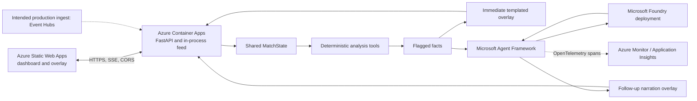

# Overseer

<<<<<<< HEAD
Overseer is a multi-agent football match-intelligence platform using synthetic
match data. Its deterministic analysis tools produce grounded facts; Microsoft
Agent Framework agents use Microsoft Foundry for optional interpretation and
narration. The API emits fact overlays before asynchronous narration so model
latency does not hold up the match feed.
=======
Overseer is a multi-agent match-intelligence platform. Specialist agents analyse team shape, pressing, patterns of play, player influence and momentum from a live event feed, writing structured, traceable facts into a shared state. A grounded Narrator renders them as timecoded broadcast overlays and personalised, multilingual commentary for broadcast, analyst and fan modes, on Microsoft Foundry and Azure.
>>>>>>> 97c9c6a95b96881b763bb878fcc79da9fe324dc5

## Architecture



The running feed and replay state are in-process. Event Hubs is the intended
production ingest, but is not part of this deployment phase. Cosmos DB and
Azure Web PubSub are also out of scope; the current overlay transport is
server-sent events (SSE).

## What runs where

| Component | Location | Responsibility |
| --- | --- | --- |
| FastAPI backend | Azure Container Apps | Match state, deterministic engine, Agent Framework calls, overlay JSON, SSE |
| Dashboard and browser overlay | Azure Static Web Apps (Free) | Browser UI, configured to call the backend API |
| Language model | Microsoft Foundry | Grounded specialist-agent and narration responses |
| Telemetry | Azure Monitor / Application Insights | Export of OpenTelemetry agent spans when configured |

The backend uses a system-assigned managed identity with the Foundry User role
on the Foundry **project** scope. Local development uses
`DefaultAzureCredential` (for example, `az login`). The application does not
use API keys.

## Status

| Capability | Status | Notes |
| --- | --- | --- |
| Deterministic analysis | Working | Existing engine functions remain deterministic and their tests are unchanged |
| Agent Framework and Foundry client | Working | Agent Framework agents use the Foundry chat client and `DefaultAzureCredential` |
| Fact-first overlays and async narration | Working | Flagged facts emit a template immediately; model calls run after emission |
| In-memory feed and replay | Working | Synthetic replay is supported; runtime state is process-local |
| SSE overlays and dashboard latency | Working | Overlay JSON contains event-to-emission latency; dashboard displays it |
| Azure Monitor tracing | Working when configured | Set `APPLICATIONINSIGHTS_CONNECTION_STRING`; otherwise the app warns and continues |
| Container Apps and Static Web Apps deployment | Designed; not deployed by this repository change | Run the PowerShell deployment script against your Azure subscription |
| Event Hubs ingestion | Intended production design | Not provisioned or enabled by the deployment script |
| Cosmos DB persistence and Web PubSub | Out of scope | Not provisioned or required for the in-process feed |

## Requirements

- Windows PowerShell 5.1 or later
- Python 3.13 for local development (the deployment container uses Python 3.12)
- An Azure subscription and Azure CLI
- A Microsoft Foundry project and a deployed model
- Node.js/npm and the Static Web Apps CLI for deployment

## Configure a local Foundry connection

From the repository root in PowerShell:

```powershell
Copy-Item .env.example .env
notepad .env
```

Set `FOUNDRY_PROJECT_ENDPOINT` to the HTTPS Foundry project endpoint and
`FOUNDRY_MODEL` to the **deployment name**. The optional
`APPLICATIONINSIGHTS_CONNECTION_STRING` may be left blank to disable Azure
Monitor export. `.env` is ignored by Git; do not commit real configuration or
credentials.

Install dependencies, sign in, and run the API:

```powershell
py -3.13 -m venv .venv
.\.venv\Scripts\python.exe -m pip install -r requirements.txt
az login
.\.venv\Scripts\python.exe -m uvicorn api.main:app --reload
```

Open `http://127.0.0.1:8000`, then choose **START REPLAY**. The app loads
`.env` through `python-dotenv`. A missing or unreachable Foundry deployment
does not stop deterministic processing; the Narrator uses its templated
fallback.

Run the Foundry smoke scripts and tests:

```powershell
.\.venv\Scripts\python.exe scripts\test_agents.py
.\.venv\Scripts\python.exe scripts\test_narrator.py
.\.venv\Scripts\python.exe -m pytest -q
```

`test_agents.py` compares ShapeAnalyst output with `engine.patterns.block()`.
`test_narrator.py` requests Broadcast/English, Analyst/Spanish, and Fan/Arabic.
Both smoke scripts allow a longer response window than the live-path timeout.

## Build and run the container locally

With Docker installed:

```powershell
docker build -t overseer-api .
docker run --rm -p 8000:8000 --env-file .env overseer-api
```

The image starts `uvicorn api.main:app` on port 8000. `.dockerignore` excludes
`.env` and virtual environments from the build context.

## Deploy to Azure from PowerShell

Create a Foundry project and model deployment first. Obtain the full Azure
resource ID of that Foundry **project**; the deployment script does not create
Foundry resources or infer the project scope from the endpoint.

1. Edit the parameters at the top of `infra/deploy.ps1`:
   - `$ResourceGroupName`
   - `$Region`
   - `$ContainerAppName`
   - `$StaticWebAppName`
   - `$FoundryProjectScope`
2. Ensure the repository-root `.env` contains the Foundry endpoint and model
   deployment name. Application Insights is optional.
3. Sign in, select your subscription, install the Static Web Apps CLI, then run:

```powershell
az login
az account set --subscription "<subscription-id>"
npm install -g @azure/static-web-apps-cli
.\infra\deploy.ps1
```

The script upgrades/adds the Container Apps Azure CLI extension, deploys the
repository source with `az containerapp up` using `--source .`,
`--ingress external`, and `--target-port 8000`, assigns the backend's
system-managed identity, and grants that identity the Foundry User role on `$FoundryProjectScope` using role
definition ID `53ca6127-db72-4b80-b1b0-d745d6d5456d`. It creates a Free
Static Web App, stages `web/` with the backend URL in `config.js`, deploys the staged
content using the Static Web Apps CLI, and restricts backend CORS to the new
Static Web App origin. The temporary staged copy is removed after deployment.

The deployment script reads environment values from the process environment
first, then from `.env`. It does not print the Foundry endpoint, connection
string, or Static Web Apps deployment token. The Azure account needs permission
to create the resources and assign roles; role assignment may require an
elevated Azure RBAC role such as Owner or User Access Administrator.

## Agent, latency, and tracing design

ShapeAnalyst, PatternSpotter, ImpactAnalyst, and MomentDetector use local,
typed engine-function tools through Agent Framework `Agent` instances backed
by `FoundryChatClient`. The Narrator receives structured facts only; it does not
read raw events. Narration instructions require it to use only supplied facts,
preserve player and club names, and follow the selected language and mode.

When a deterministic analysis flags a fact, Overseer emits the templated fact
overlay before scheduling narration and specialist-agent calls. No model call
is made for an unflagged event. Model calls use bounded timeouts and fallback
behavior so slow or unavailable Foundry does not block the feed. `latency_ms`
in overlay JSON measures wall-clock time from input-event receipt to overlay
creation; the dashboard shows the latest overlay latency.

At application startup, Azure Monitor is configured once if
`APPLICATIONINSIGHTS_CONNECTION_STRING` is populated. Missing or invalid
configuration produces a warning and does not prevent the service from
starting. Agent spans are named `agent.<name>` and include `agent.name`,
`fact.ids`, and `agent.latency_ms`. Raw prompts and connection strings are not
recorded as span attributes.

## Responsible AI and limitations

- Match records are synthetic unless a separately configured upstream source
  provides data. Synthetic output must not be presented as broadcast evidence.
- Narration is grounded in supplied facts and has a deterministic template
  fallback; generated narration can still be incomplete or misleading and
  should be reviewed before broadcast.
- Fact IDs and spans support traceability but do not constitute a guarantee of
  model correctness.
- Match state, recent overlays, and narration cache are in process and are not
  shared across replicas or persisted across restarts.
- Event Hubs is the intended production ingestion service. This phase retains
  the in-process feed; Event Hubs, Cosmos DB, and Web PubSub infrastructure
  are not provisioned here.
- Verify target-region availability, pricing, quota, managed-identity role
  assignment, CORS behavior, and Static Web Apps deployment permissions before
  production use.
