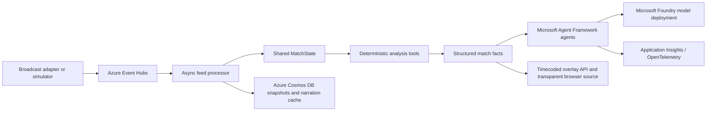

# Overseer

Overseer is an Azure-native live football match-intelligence platform. Its
primary data path is a broadcast-feed adapter or synthetic producer, Azure
Event Hubs, an ordered processor, deterministic analysis, and machine-readable
overlay output. Laptop execution is a development convenience, not the
deployment model.

## Architecture in this refactor



The feed package, sequence handling, Cosmos persistence interfaces, deterministic
analysis, and Foundry-backed agent layer are implemented. The API now publishes
validated overlay JSON through SSE, retains recent overlays for late joiners,
and serves a transparent browser-source page. The current match-control and
dashboard state source uses the replay adapter when Event Hubs is not configured.
When `EVENTHUB_NAMESPACE` is set, the API starts the ordered feed processor and
publishes snapshots and overlays from ingested match data. Azure deployment
automation is provided by `infra/deploy.sh`. The deployed processor/API is
single-replica because `MatchState` is held in memory; Cosmos DB stores
snapshots and narration cache records, not a distributed live state lock.

## Azure resources and configuration

Configure Azure resources and identity before running the live feed path:

- Event Hubs namespace and the `match-events` event hub. The app identity needs
  Event Hubs Data Sender or Data Receiver as appropriate.
- Cosmos DB serverless account, database, and containers. The app identity
  needs Cosmos DB data-plane permissions. Snapshot container partition key:
  `/match_id`; narration cache partition key: `/cache_key`.
- A Microsoft Foundry project and a deployed model. The app identity needs the
  Foundry project inference role for that deployment.
- Optional Application Insights connection string for trace export.

Copy `.env.example` and set values using the deployment platform's secret and
configuration store. Do not commit credentials. Event Hubs, Cosmos DB, Foundry,
and Translator use `DefaultAzureCredential`. A Foundry-only API-key fallback
is supported through `FOUNDRY_API_KEY` if Entra authentication is unavailable;
its project-endpoint header behavior requires manual verification.

## Azure deployment

`infra/deploy.sh` provisions the Azure resources and deploys the API/processor
container and the Static Web App. It expects a Bash-capable host (Linux, macOS,
WSL, or Git Bash), Azure CLI already logged into the target subscription, plus
`npx`, `python3`, and `curl`. Create a Foundry project and model deployment
first; the script requires its project endpoint, model name, and Foundry
resource ID. The script does not create or deploy the Foundry project/model.

From the repository root, configure the environment from a private `.env`
file (not committed) or export these required values directly:

```bash
cp .env.example .env
# Edit .env and set the Foundry project endpoint, deployment, and resource ID.
set -a
source .env
set +a
export FOUNDRY_PROJECT_ENDPOINT="https://<your-foundry-project-endpoint>"
export FOUNDRY_MODEL="<your-model-deployment>"
export FOUNDRY_RESOURCE_ID="<your-foundry-resource-id>"
bash infra/deploy.sh
```

`.env.example` lists supported runtime and deployment overrides. The script
creates a resource group, Log Analytics workspace, Application Insights
resource, Basic Event Hubs namespace and hub, serverless Cosmos DB account and
containers, Basic Container Registry, Container Apps environment, the
single-replica API/processor, a manual-trigger simulator Container Apps Job,
and a Static Web App. It grants managed identities Event Hubs and Cosmos data
access, ACR image-pull access, and the configured Foundry role. The API URL is
injected into the staged web `config.js` during Static Web Apps deployment.
The deployment uses ACR Tasks to build the Docker image; a local Docker daemon
is not required.

After deployment, the script prints the API, Static Web App, and browser-source
URLs. Start synthetic feed publishing with the printed job command:

```bash
az containerapp job start --resource-group <printed-resource-group> --name <printed-simulator-job>
```

The simulator job uses a system-assigned identity with Event Hubs Data Sender
permission. For a live production broadcast, replace the simulator with a
feed adapter publishing the same ordered envelope format; do not treat
synthetic events as broadcast observations.

### Cost and responsible AI

Costs are driven by always-on Container Apps compute, Application Insights and
Log Analytics ingestion/retention, Event Hubs throughput, Cosmos DB request
units and stored data, model inference, Container Registry storage/builds, and
Static Web Apps usage. The simulator Job incurs compute only while running.
Basic Event Hubs and free Static Web Apps are starting-tier defaults, not
capacity or production recommendations; verify quotas, availability, pricing,
and failover requirements for the target region and match workload.

Synthetic data is visibly labelled in the dashboard and must not be presented
as live match evidence. Narration is grounded only in supplied deterministic
facts; fallback templates keep overlays flowing when model calls time out.
Tracing carries fact identifiers for claim lineage. Content Safety is an
optional disabled-by-default guard and is not a substitute for editorial
review.

### Needs manual verification before production

- Confirm the Foundry User role and its assignment scope for the target tenant,
  project, and model deployment.
- Confirm deployment-region availability, pricing, Basic-tier quotas, and
  throughput for Event Hubs, Cosmos DB, Container Apps, and Static Web Apps.
- Validate the managed-identity Foundry token path and the optional API-key
  fallback against the actual Foundry project endpoint.
- Exercise the script, RBAC propagation, ACR Tasks, Container Apps Job, and
  Static Web Apps deployment in the target Azure subscription.
- Load-test the single-replica processor, SSE fan-out, partitioning, Cosmos
  persistence, and overlay timing with representative broadcast traffic.

Current Foundry documentation uses `FOUNDRY_PROJECT_ENDPOINT` and
`FOUNDRY_MODEL` for `FoundryChatClient`; the latter is the documented model
setting (rather than `FOUNDRY_MODEL_DEPLOYMENT`). Foundry connector and
orchestration packages are declared separately from Agent Framework core in
`requirements.txt`.

The in-process feed queue is selected automatically when
`EVENTHUB_NAMESPACE` is unset. It logs a warning and is only suitable for
single-process development; it is not a distributed substitute for Event Hubs.
Start the feed simulator with `python -m feed.simulator`. It publishes processed
clip records before the synthetic match and accepts `--speed`, `--seed`,
`--match-id`, `--clip-events`, and `--clip-frames`.

## Agent and latency behavior

Microsoft Agent Framework agents have distinct roles: Orchestrator,
ShapeAnalyst, PatternSpotter, ImpactAnalyst, MomentDetector, Narrator, and
FanCurator. Specialist tools call the existing deterministic analysis and
write only their assigned `MatchState` section. The live fast path computes
deterministic facts without waiting for model inference.

Narrator receives a structured fact payload, does not translate player or club
names, and supports English, Spanish, Arabic, and French. Calls have a four
second default timeout and one retry. If Foundry is unavailable, the stream can
continue with a deterministic language- and mode-specific template; degraded
calls are logged and marked as fallback output. Successful narration is cached
in memory and, when configured, read-through to Cosmos DB using fact ID, mode,
language, and favourite as the cache key.

FanCurator requests a Pydantic-validated JSON filter object and rejects teams or
players that are absent from the match. If structured output fails, it falls
back to the deterministic request parser. Optional Azure AI Translator is
disabled by default (`AZURE_TRANSLATOR_ENABLED=0`) and uses the configured
Translator endpoint with the app's Entra identity. Azure AI Content Safety is
also disabled by default (`AZURE_CONTENT_SAFETY_ENABLED=0`); when enabled, it
checks narration and replaces rejected output with the deterministic template.

Agent and deterministic tool spans include names, fact IDs, and latency.
`APPLICATIONINSIGHTS_CONNECTION_STRING` enables Azure Monitor export. Narration
prompts and raw player/frame payloads are not added as span attributes.

## Overlay output and browser source

The API validates every broadcast message against one Pydantic schema before
publishing it. `GET /stream` sends state snapshots as normal SSE messages and
overlay JSON as named `overlay` events. `GET /overlays/recent?limit=100`
returns overlays whose broadcast duration is still active, for clients joining
mid-match. Each overlay
includes a monotonic sequence, match clock/timecode, duration, priority,
language/mode, fact lineage, and optional statistics/player/team/pitch
markings.

Open `/overlay` as a transparent 1920×1080 browser source in OBS. The renderer
loads recent overlay JSON, then follows SSE snapshots for match-clock timing
and overlay events for priority-sorted cards and pitch markings. Dashboard
configuration lives in `web/config.js` (`OVERSEER_API_BASE_URL`). When the
Static Web App and API use different origins, set `CORS_ALLOWED_ORIGINS` to the
exact Static Web App origin(s); wildcard CORS is rejected.
Setting `WEB_PUBSUB_CONNECTION` enables an additional Azure Web PubSub fan-out
using `WEB_PUBSUB_HUB`; SSE remains enabled as the default transport.

The dashboard displays the latest overlay and its raw JSON alongside the
rendered preview. Its synthetic-data badge remains visible, and the latency
indicator reports feed-envelope `wall_time_utc` to deterministic fact-overlay
emission when Event Hubs is active. The replay adapter uses record receipt time
because replay records do not carry a feed envelope.

## Developer convenience: run against Azure resources

The API development shell can be run on a laptop while authenticating to
configured Azure resources:

```powershell
python -m pip install -r requirements.txt
az login
python scripts\dev_run.py --reload
```

Set `EVENTHUB_NAMESPACE`, `COSMOS_ENDPOINT`, `FOUNDRY_PROJECT_ENDPOINT`, and
`FOUNDRY_MODEL` from your Azure resources before running the script. It starts
the API, which starts its live Event Hubs processor as part of application
startup; it does not start a local feed emulator. Use the Azure simulator Job
or an external feed adapter to publish messages. This laptop command is a
developer convenience, not the production deployment path. In Azure, use a
managed identity instead of developer credentials. Configure
`CORS_ALLOWED_ORIGINS` with the exact Static Web App origin when deploying the
browser client.

## Deterministic analysis validation

The football analysis engine remains deterministic. Run its tests and the
complete test suite with:

```powershell
python -m pytest -q tests\test_patterns.py
python -m pytest -q
python tests\smoke.py
```

The smoke check uses a fake agent defined in the test directory; there is no
runtime mock-LLM mode.

## Processed video input

Video processing remains an upstream feed-adapter task. Use a short wide-angle
MP4 with no camera cuts and a per-clip calibration file based on
`vision/config/clip1.json`. Detect tracks, map tracker IDs to the roster, and
produce schema-compatible event and frame JSON:

```powershell
python -m pip install -r vision\requirements.txt
python -m vision.track clips\clip1.mp4 --device cpu
python -m vision.events_from_tracks clips\clip1.mp4 --config vision\config\clip1.json --roster-map vision\roster_map.json --tracks outputs\clip1_tracks.json --device cpu
```

Publish the processed clip data before synthetic events by supplying the files
to the simulator:

```powershell
python -m feed.simulator --clip-events outputs\clip1_events.json --clip-frames outputs\clip1_frames.json --speed 1
```

For production, a broadcast feed adapter should publish the processed records
to Event Hubs using the match ID as the partition key. Each feed message carries
the match ID, sequence, match clock, UTC wall time, source, and typed payload.
